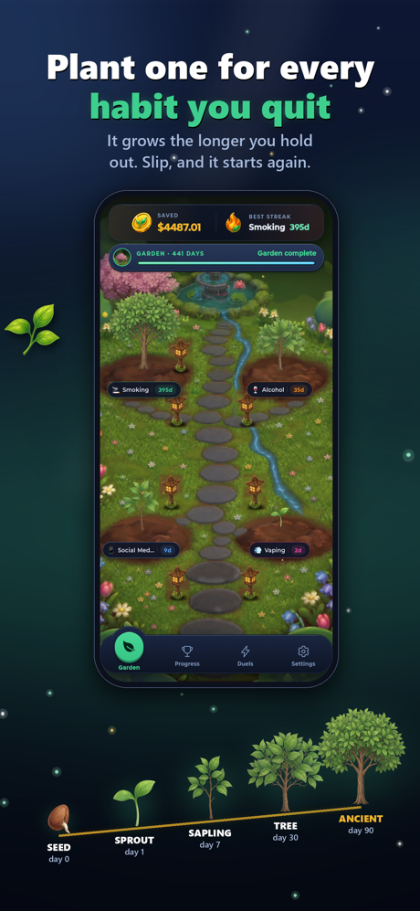
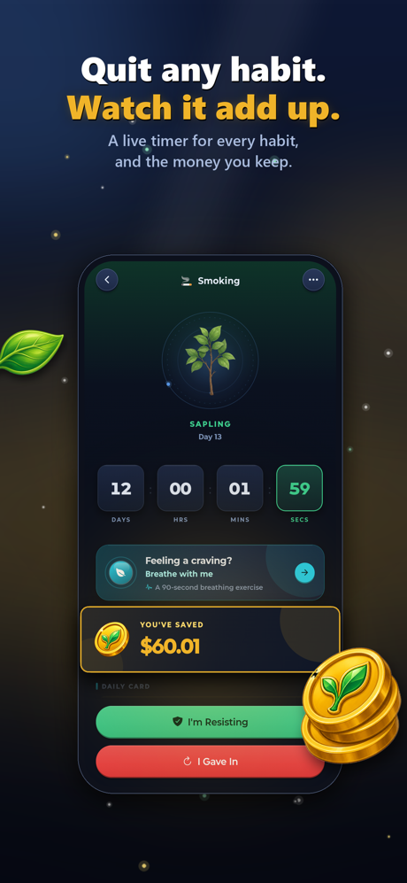
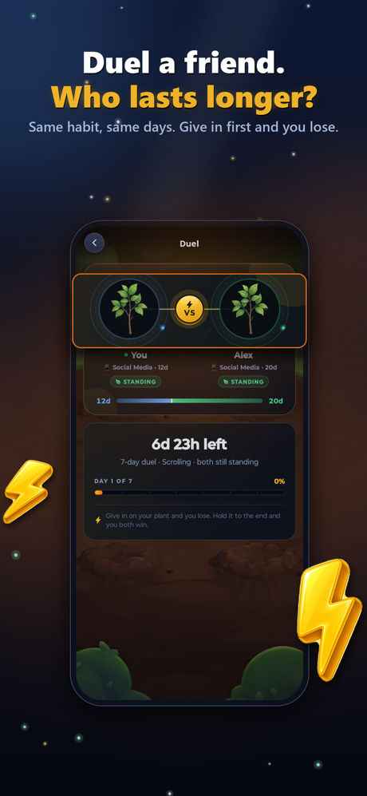
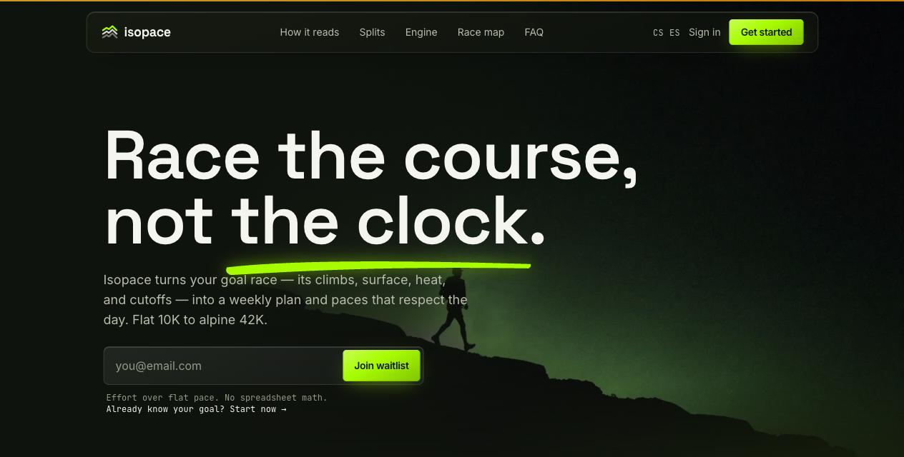
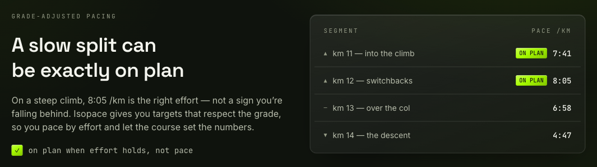
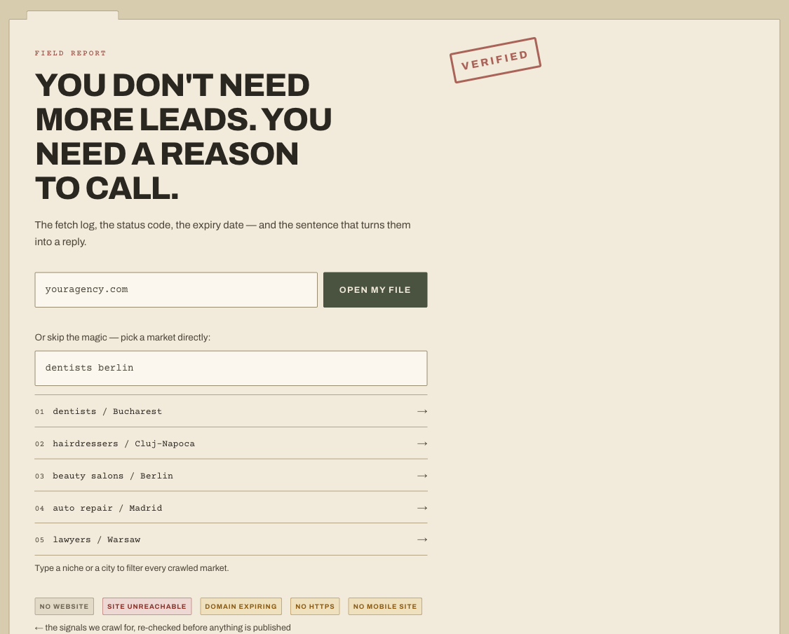

<h1 align="center">What we have built</h1>

Four products, all live, all built by people on this team. 
This page goes with our Hackstage 2026 application.

| Product | What it is | Where it stands |
|-|-|-|
| [Roots](#roots) | A mobile app for quitting habits, built around a garden that grows | Live on the App Store and Google Play, rated 5.0 on both |
| [Isopace](#isopace) | Running plans built around one specific race course | Early access with a first group of athletes, two partners |
| [EngageTrack](#engagetrack) | Web analytics that shows which channels bring paying customers | Live with paid plans, 1,000,000+ events a month |
| [Local Evidence](#local-evidence) | Leads for web agencies, each one with its proof | 336 markets live across 10 cities, in 3 languages |

Between them, the four cover most of what a 24-hour product needs:

- An app people open every day. Roots runs on streaks, friends and duels.
- Money. EngageTrack reads Stripe, Shopify and Lemon Squeezy and ties a sale to where the customer came from.
- Data nobody types in by hand. Local Evidence crawls, re-checks and publishes 336 markets.
- A product that adapts to its user. Isopace changes the plan after every run.

## Roots

A mobile app for quitting smoking, vaping, drinking, scrolling, or any habit you name yourself.

You plant a seed for every habit you want to stop, and the plant grows for as long as you hold out: a sprout after a day, a sapling after a week, a tree after a month, an ancient tree at 90 days. Slip, and it goes back to a seed. Up to four habits grow side by side, and the garden around them changes over a year, from bare soil to cherry blossom.

The rest of the app is built to bring you back tomorrow. A live timer counts the days, hours and seconds since the last cigarette or drink, with the money you kept counted next to it. When a craving hits, one button starts 90 seconds of guided breathing. After a slip the app asks what set it off, and a few entries later it shows your most common trigger. Friends see each other's gardens and challenge each other to duels of 3, 7, 14 or 30 days. Whoever gives in first loses. If both hold out, both win.

Roots is live on iOS and Android, free with a paid tier, and rated 5.0 on both stores (26 reviews so far).

[App Store](https://apps.apple.com/ro/app/roots-quit-bad-habits-grow/id6808912952) · [Google Play](https://play.google.com/store/apps/details?id=com.fineasbn.roots)

## Isopace

Most training plans count weeks. Isopace starts from the race.

You give it your goal race, as a GPX file or picked from its race map. It reads the distance, the climbs, the surface, the altitude, the heat and the cutoff times, then builds the weeks of training and a pace target for every kilometre of race day. The targets follow the gradient: on a steep climb, 8:05 per km can be exactly on plan, and the app says so.

After every run the plan is adjusted, from Strava or from a .fit or .gpx file out of a Garmin, Coros or Suunto watch. It covers flat 10K road races up to alpine marathons, and the site runs in English, Czech and Spanish.

Isopace is in early access with a first group of athletes. Český běh and Winter TRAIL are partners. Built with Go and Next.js.

[isopace.run](https://isopace.run/en)

## EngageTrack

Web analytics for SaaS companies that answers one question: which channel brought the customers who paid?

It connects to Stripe, Shopify and Lemon Squeezy and ties each sale back to the traffic source it came from. By default it stores nothing on the visitor's device, so a site that uses it needs no cookie banner. It works with WordPress, Webflow, Next.js, React, Vue, Svelte and Ghost.

Behind it are a Go ingestion API and PostgreSQL. The browser batches events before it sends them, which keeps the service cheap to run at 1,000,000+ events a month.

Paid plans are live at EUR 5, 19 and 49 a month, with a 14-day free trial.

[engagetrack.net](https://engagetrack.net)

## Local Evidence

A web agency looking for clients usually buys a list and hopes. Local Evidence gives it a reason to call.

It crawls local businesses, such as dentists in Bucharest, hairdressers in Cluj-Napoca or lawyers in Warsaw, and looks for five problems: no website, a site that does not load, a domain about to expire, no HTTPS, no mobile version. Every finding is checked again against the live site before it is published, and it carries the time of that check. A finding that cannot be confirmed is marked unverified and gets no ready-made message. Each confirmed lead comes with its evidence and a first message the agency can send.

The hard part is knowing that two records describe the same business. Local Evidence matches entries across OpenStreetMap, Overture, web search and WHOIS, scores the evidence for each finding, and compiles one data pack per city. Built with Go, TypeScript, Next.js and SQLite.

336 markets are live across 10 cities and 36 niches, in English, Romanian and Czech. Nobody has to sign up to look.

[localevidence.com](https://www.localevidence.com/en)
